# Awesome-Enterprise-Knowledge-Graphs-Automated-Ontologies


  





  
  
  
  
  



# 🕸️ Top Enterprise Knowledge Graphs & Automated Ontologies

**Curated List of SaaS/Commercial Platforms & Open-Source GitHub Projects**  
*Focused on Graph Databases (LPG & RDF/OWL), LLM-Driven Automated Ontology Induction, GraphRAG Memory Engines & Semantic Reasoning*  
**Last updated: November 2026**

This repository tracks notable **SaaS/Commercial platforms** and **open-source projects** for **Enterprise Knowledge Graphs & Automated Ontologies**. These tools power native Labeled Property Graph (LPG) and W3C RDF/SPARQL/OWL triple stores, LLM-powered automated ontology generation (`NVIDIA/auto-ontology`, `GraphRAG`), GraphRAG enterprise memory engines (`Graphiti`, `Cognee`, `LightRAG`), and embedded graph analytics for enterprise AI architects, semantic engineers, and data scientists.

**Examples** include Amazon Neptune (AWS), Neo4j Aura, TigerGraph Cloud, Cambridge Semantics (Altair Anzo), ArangoDB Oasis (ArangoGraph), Memgraph Cloud, Stardog Cloud, Katana Graph, Dgraph Cloud, and TypeDB / Grakn Core (Vaticle) (the category leaders).

**🚀 Open-source emphasis**: This section is heavily expanded with every major active project for automated ontology induction (`NVIDIA/auto-ontology`, `GraphRAG`, `Graphiti`, `Cognee`, `LightRAG`), open-source graph databases (`Neo4j Community`, `Memgraph`, `Kùzu`, `Dgraph`, `Apache Jena`, `Oxigraph`, `NebulaGraph`, `JanusGraph`, `TypeDB`), and ontology/OWL toolkits (`Protégé`, `ROBOT`, `RDFLib`, `PyKEEN`) — ideal for AI teams building grounded, hallucination-resistant enterprise knowledge systems without proprietary lock-in.

🤝 Contributions welcome! Open a PR to add/update entries. Keep descriptions factual and link to official sites.

## 📑 Table of Contents
- [📊 Sector Overview & Market Dynamics](#-sector-overview--market-dynamics)
- [☁️ SaaS/Hosted & Commercial Platforms](#️-saashosted--commercial-platforms)
- [💻 Open-Source GitHub Projects](#-open-source-github-projects)
- [🛠️ How to Contribute](#️-how-to-contribute)
- [⚠️ Disclaimer](#️-disclaimer)
- [💖 Support & Thank You](#-support--thank-you)

## 📊 Sector Overview & Market Dynamics

The global Graph Database & Enterprise Knowledge Graph market is valued at approximately **$3.8B–$4.9B+ in 2026**, expanding at a ~22%–28% CAGR toward $15B+ by 2032—propelled by **GraphRAG**, neuro-symbolic AI, and automated LLM ontology construction. The commercial cloud graph database layer exhibits **strong winner-take-most consolidation** around Neo4j and hyperscaler offerings like Amazon Neptune, while the emerging **automated ontology & GraphRAG memory layer** is **rapidly innovating and predominantly open-source** (`NVIDIA/auto-ontology`, `Microsoft GraphRAG`, `Graphiti`, `Cognee`, `Kùzu`, `Oxigraph`).

## ☁️ SaaS/Hosted & Commercial Platforms

*Sorted descending by company valuation / annual revenue scale.*

| Platform | Description | Company Scale (Valuation / Revenue) | Starting Paid Tier | Free Tier / Trial Limit |
| :--- | :--- | :--- | :--- | :--- |
| **[Amazon Neptune](https://amazon.com)** | Fully managed AWS graph database supporting both Labeled Property Graphs (openCypher/Gremlin) and W3C RDF/SPARQL plus Neptune Analytics. | **Part of Amazon / AWS** (~$115B+ AWS annual revenue; ~$2T+ parent market cap) | **~$0.10 / hour** (~$73/mo) for `db.t4g.medium` instance + storage/I/O | **30-Day Free Trial** (**750 hours** of `db.t3.medium`/`db.t4g.medium`, 10M I/O requests, and 1 GB storage free for 30 days) |
| **[Neo4j Aura](https://neo4j.com)** | Fully managed cloud native graph database and graph data science platform featuring Cypher, native vector search, and GraphRAG integrations. | **$2.0B+ Valuation** (~$200M+ ARR) | **$65 / month** ($0.09/hr) for AuraDB Professional (1 GB RAM, 2 GB storage) | **Forever Free AuraDB Free** (Up to **200,000 nodes and 400,000 relationships** free forever; 14-day Pro trial) |
| **[TigerGraph Cloud](https://tigergraph.com)** | Massively parallel distributed graph database and analytics SaaS designed for deep multi-hop real-time queries and enterprise GraphRAG. | **~$500M–$800M Est. Valuation** (~$40M–$60M est. ARR; $170M+ VC funding) | **~$0.24 / hour** (~$175/mo) for TG.Free-to-Starter cloud instances | **Forever Free Cloud Tier** (1 free instance with up to **50 GB storage** and starter GraphStudio visual builder; 14-day Enterprise trial) |
| **[Cambridge Semantics (Altair Anzo)](https://altair.com)** | Enterprise knowledge graph and semantic data-fabric platform automating RDF/OWL ontology integration across structured and unstructured silos. | **Part of Altair Engineering / Siemens** (Acquired by Altair; Siemens acquired Altair for $10.6B) | **Enterprise Contract Licensing** (~$50,000+ / year indicative enterprise Anzo platform subscription) | **Guided Enterprise Demo / Sandbox** (No public self-serve free tier; custom proof-of-value sandbox via enterprise sales) |
| **[ArangoDB Oasis (ArangoGraph)](https://arangodb.com)** | Managed multi-model graph, document, and vector database cloud platform supporting AQL queries, Pregel graph analytics, and GraphRAG. | **~$100M–$150M Est. Valuation** (~$15M–$25M est. ARR; $47M+ VC funding) | **~$0.25 / hour** (~$180/mo) for ArangoGraph One-Shard Starter deployment | **14-Day Free Trial** (Full managed ArangoGraph cluster access with no credit card required; self-hosted Community Edition is free) |
| **[Memgraph Cloud](https://memgraph.com)** | Ultra-fast, in-memory C++ graph database cloud compatible with Neo4j Cypher and Bolt, engineered for real-time streaming and GraphRAG. | **~$40M–$70M Est. Valuation** (~$10M–$15M est. ARR; backed by M12/InReach) | **~$50 / month** ($0.07/hr) for Memgraph Cloud Basic (1 GB RAM + 5 GB disk) | **14-Day Free Trial** (Full Memgraph Cloud instance with Memgraph Lab UI; self-hosted Memgraph Community is 100% free forever) |
| **[Stardog Cloud](https://stardog.com)** | Enterprise knowledge graph platform uniting W3C RDF/OWL semantic reasoning, virtual graphs (data virtualization), and Voicebox LLM querying. | **~$50M–$80M Est. Valuation** (~$10M–$15M est. ARR; $35M+ VC funding) | **~$250 – $500 / month** indicative starting Essentials/Standard cloud tier | **Forever Free Stardog Cloud Tier** (Up to **500,000 triples**, Stardog Studio, and Voicebox trial credits; 14-day full Enterprise trial) |
| **[Dgraph Cloud (Hypermode)](https://dgraph.io)** | Distributed, horizontally scalable native GraphQL and RDF-inspired graph database cloud platform built in Go for low-latency traversals. | **~$30M–$50M Est. Valuation** (Maintained by Hypermode; $26M+ prior VC funding) | **$99 / month** for Dedicated single-node cluster (or **$9.99/mo** legacy shared tier) | **Forever Free Shared Backend / 14-Day Trial** (Free shared GraphQL backend with daily query limits; self-hosted Dgraph Apache-2.0 is free) |
| **[Katana Graph (Intel / Legacy Reference)](https://intel.com)** | High-performance distributed graph processing, AI, and analytics engine built for massive-scale graph neural networks and sub-second queries. | **~$100M+ Peak Valuation** (IP & engineering talent acquired/integrated across Intel/AI labs) | **Enterprise / Cloud Cluster Licensing** (No standalone public SaaS signup post-restructuring) | **Open-Source Galois / Katana Core** (Underlying C++ Galois parallel graph analytics framework remains open-source on GitHub) |
| **[TypeDB Cloud (formerly Grakn Core / Vaticle)](https://typedb.com)** | Strongly-typed polymorphic database and symbolic reasoning engine bridging knowledge graphs, relational models, and automated rule inference. | **~$20M–$40M Est. Valuation** (~$15M+ VC funding) | **~$0.20 / hour** (~$145/mo) for TypeDB Cloud Development cluster | **14-Day Free Trial** (Full managed TypeDB Cloud cluster + TypeDB Studio; self-hosted TypeDB Core is free under MPL-2.0) |

## 💻 Open-Source GitHub Projects

| Project | License / Hosting Cost | Free Tier / Self-Hosted Limit | Description |
| :--- | :--- | :--- | :--- |
| **[NVIDIA Auto-Ontology (`NVIDIA/auto-ontology`)](https://github.com)** | **Open-Source** ($0 local/GPU pipeline; BYO NVIDIA NIM or LLM endpoints) | **100% Free forever** (Unlimited automated ontology induction, entity/relation schema synthesis, and KG construction from text) | NVIDIA's open-source automated ontology generation toolkit that induces structured domain ontologies and knowledge graphs directly from unstructured documents. |
